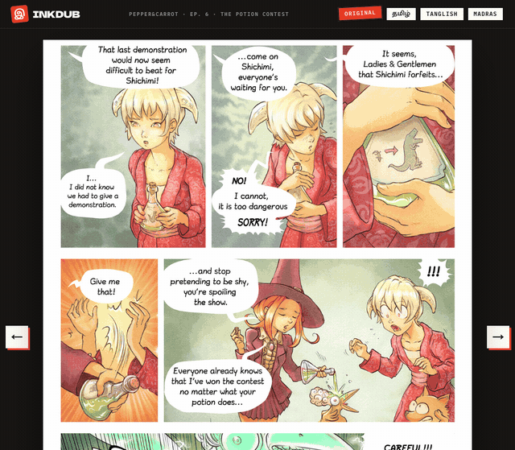
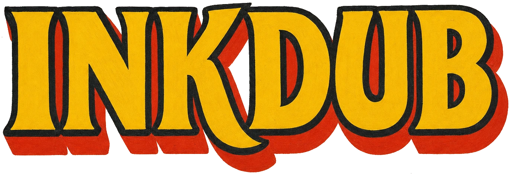
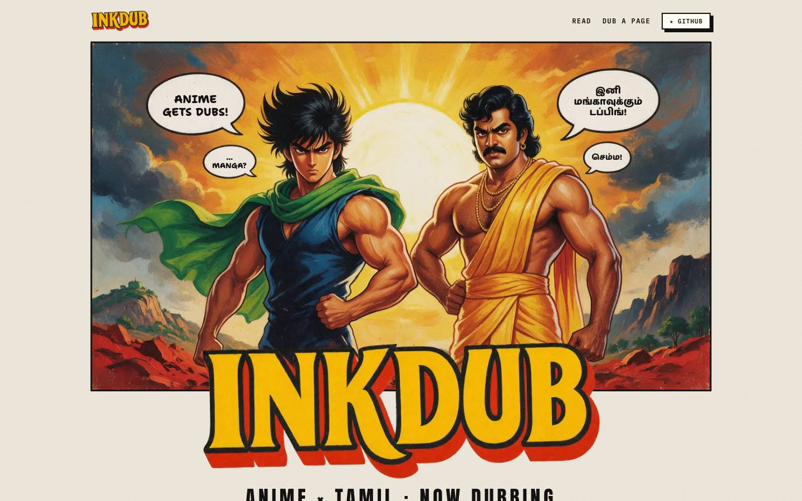
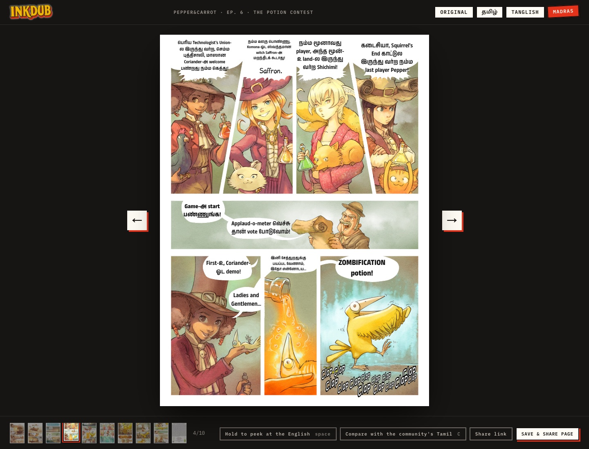
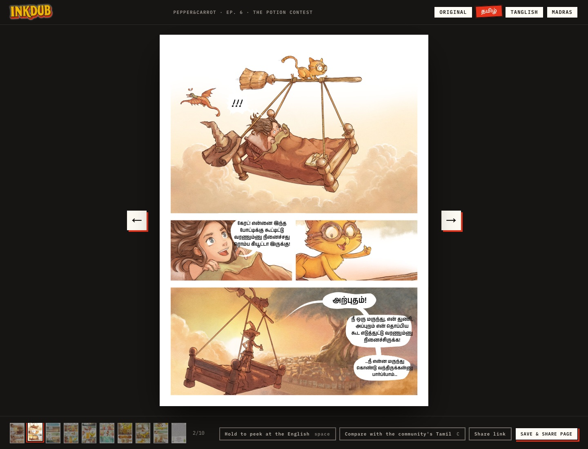
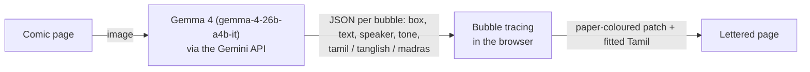

<p align="center">
  
</p>

<h1 align="center"></h1>

<p align="center">
  <b>Anime gets dubs. Manga never did.</b><br>
  Read any comic in Tamil, Tanglish or Madras Bashai, lettered right inside the speech bubbles by Gemma 4.
</p>

<p align="center">
  <a href="https://inkdub-app.vercel.app"><b>Try it live</b></a> ·
  <a href="https://inkdub-app.vercel.app/read?page=4&view=madras">Read an episode in Madras Bashai</a> ·
  <a href="https://inkdub-app.vercel.app/dub">Dub your own page</a> ·
  <a href="docs/inkdub-demo.mp4"><b>▶ Demo video</b></a>
</p>

> **Demo video** ([`docs/inkdub-demo.mp4`](docs/inkdub-demo.mp4), 90 s): the landing banner, one page re-lettered into Tamil, Tanglish and Madras Bashai, and a **live Gemma 4 dub** of a page, recorded in real time (the wait for Gemma is not sped up). Recorded with [`scripts/record-demo.mjs`](scripts/record-demo.mjs).

<p align="center">
  <a href="LICENSE"></a>
  <a href="https://ai.google.dev/gemma/docs/core"></a>
  
  
</p>

---

Anime has Tamil dubs now. Manga, manhwa and comics still don't. Inkdub fixes that for any page you can screenshot:

- **Gemma 4 reads the page.** One multimodal call finds every speech bubble, thought bubble and caption, reads it, and works out who is speaking and how.
- **It localizes, not translates.** Every line comes back three ways: clean **Tamil**, casual **Tanglish**, and full **Madras Bashai**, with honorifics and jokes adapted for Tamil readers.
- **Inkdub letters it back into the art.** The browser traces each bubble's real shape, paints over the original lettering with the bubble's own paper colour, and fits the Tamil inside.



| Page 4 in Madras Bashai | Page 2 in Tamil |
| --- | --- |
|  |  |

## What you can do

- **Read a whole episode in Tamil.** All 10 pages of Pepper&Carrot episode 6 at [`/read`](https://inkdub-app.vercel.app/read), with a style switch (keys `1`–`4`), page turns (`←` `→`), and a tap on any bubble to see the original, the speaker and all three dubs.
- **Peek at the original.** Hold `space` (or the button) to see the English underneath.
- **Compare with human translators.** Press `C` to swap in the Pepper&Carrot community's own Tamil edition of the same page.
- **Dub your own page, live.** Drop, upload or paste (⌘V) any comic or manga page at [`/dub`](https://inkdub-app.vercel.app/dub) and paste your free Gemini API key. Gemma 4 letters it in about 15–40 seconds. The sample pages work without a key.
- **Save and share a page.** One tap renders the lettered page as an image with an Inkdub credit strip and opens your phone's share sheet (WhatsApp, Instagram), or downloads it on a laptop.
- **Share a moment.** Links like [`/read?page=7&view=madras`](https://inkdub-app.vercel.app/read?page=7&view=madras) open on that page, in that style. On a phone, swipe to turn pages.

## Design

Inkdub is designed like a printed manga, not a software landing page: newsprint paper, true-black ink, one hanko-seal red, and copy that lives in real speech bubbles. It opens on a hand-painted Kollywood-style banner, an anime hero beside a Tamil hero, whose empty speech bubbles Inkdub has lettered, under a movie-poster title and billing block.

- **Panels, not cards.** Sections are inked panels with slanted gutters, focus lines and screentone. Their borders ink themselves in as they scroll into view.
- **Lettering you can watch.** Tamil wipes on left to right like a brush stroke, shouts land with a punch, and the style switch is a row of rubber stamps.
- **A quiet reading room.** The reader drops the noise: a dark surround, pages that turn on their spine, a filmstrip of thumbnails.
- **Type:** Shantell Sans for hand lettering, Dela Gothic One and Anton for poster titling, IBM Plex Mono for printed labels, Anek Tamil (semi-condensed) for Tamil lettering, Baloo Thambi 2 for display Tamil.

## How it works



1. **One Gemma 4 call per page** ([`lib/gemma.ts`](lib/gemma.ts)). The page image and a localization prompt go to `gemma-4-26b-a4b-it` through the Gemini API with the official [`@google/genai`](https://www.npmjs.com/package/@google/genai) SDK. Gemma returns every bubble as JSON: a bounding box (`box_2d`, normalized 0–1000), the original text, the speaker, the tone, and the three localizations. Malformed JSON is repaired, every field is validated, transient 5xx errors are retried, and `gemma-4-31b-it` takes over if the 26B endpoint is down.
2. **Bubble tracing** ([`components/DubbedPage.tsx`](components/DubbedPage.tsx)). From each box, the browser samples the bubble's paper colour, flood-fills the paper outward, and treats everything the paper encloses as original lettering. A closed bubble gets its whole interior repainted. A bubble cut open by the panel edge only gets the enclosed letters near Gemma's box, so the gutter and nearby art are never touched.
3. **Lettering** ([`components/FitText.tsx`](components/FitText.tsx)). The Tamil is set in Baloo Thambi 2 and binary-searched to the largest size that fits. Shouts are heavier and pop in; switching styles ripples across the page with [Motion](https://motion.dev).

### Bring your own key

Inkdub has no backend and no AI bill. On `/dub`, each reader pastes their own [free Gemini API key](https://aistudio.google.com/apikey), and the browser calls Gemma 4 directly with the same [`lib/gemma.ts`](lib/gemma.ts) the batch script uses. So:

- **The key stays with the reader.** It is checked with one cheap call, kept in that browser's `localStorage` ([`lib/key.ts`](lib/key.ts)), sent only to Google, and can be forgotten with one click.
- **Pages never touch Inkdub's server.** They go from the browser straight to the Gemini API.
- **It scales for free.** Every reader brings their own quota, so a traffic spike costs nothing and can't exhaust anyone else's.
- **No key? Still a demo.** The three sample pages show the dub Gemma made of them earlier, labelled as such, and the whole bundled episode in the reader needs no key at all.

The bundled episode was dubbed once and cached as JSON in [`public/comics/pepper-carrot/ep06/gemma`](public/comics/pepper-carrot/ep06/gemma), so the reader is instant.

## The model

- **Gemma 4 26B A4B, instruction-tuned (`gemma-4-26b-a4b-it`)**: an open-weight mixture-of-experts model from Google, released under the [Apache 2.0 license](https://opensource.googleblog.com/2026/03/gemma-4-expanding-the-gemmaverse-with-apache-20.html). Docs: [ai.google.dev/gemma](https://ai.google.dev/gemma/docs/core).
- **Fallback:** `gemma-4-31b-it`, the dense 31B model, same license.
- **Thinking set to `MINIMAL`.** In our tests that cut a full page from about 50 seconds to about 15, with no visible quality loss.

### What we measured while building

| Test | Result |
| --- | --- |
| Bubble detection on a test page, 26B | 5 of 5 bubbles, every word read exactly, sound effects correctly skipped, mean box overlap (IoU) 0.89 |
| Same test, 31B | 5 of 5 bubbles, mean IoU 0.70, about twice as slow |
| Find + read + localize a real page in one call (26B, minimal thinking) | 15–40 s per page, depending on how many bubbles it has |
| Thinking on vs minimal (26B, same request) | 50 s and 1,862 thought tokens vs 11 s and none |
| Free-tier reliability | Intermittent HTTP 500s under load, hence retries and the 31B fallback |

## Why open matters here

- **Comic translation is volunteer work.** [Pepper&Carrot](https://www.peppercarrot.com) is translated into 69 languages by its community, and the Tamil edition is 21% done. Inkdub drafts every bubble so a Tamil reader only has to review, not start from a blank page.
- **Open weights mean no gatekeeper.** Gemma 4 is Apache 2.0, so fan translators can run the same model on their own machines with no per-page bill, and a community can fine-tune it for Tamil comics and share the result.
- **Inkdub is Apache-2.0 too.** Add your language, your slang, your favourite series.

## Run it locally

```bash
git clone https://github.com/ShaanGS/inkdub && cd inkdub
pnpm install
pnpm dev                     # http://localhost:3000, then paste your key on /dub
```

| Script | What it does |
| --- | --- |
| `pnpm dev` / `pnpm build` / `pnpm start` | Develop, build, serve |
| `pnpm lint` | ESLint |
| `pnpm dub:episode public/comics/pepper-carrot/ep06` | Dub an episode with the same pipeline as `/dub` and cache the JSON (skips pages already done). Reads `GEMINI_API_KEY` from `.env.local` (copy `.env.example`) |
| `pnpm shoot` | Rebuild the README screenshots and the social card from a running production server |

## Project layout

```
app/
  page.tsx            landing page
  read/               episode reader (deep-linkable)
  dub/                live dubbing for your own pages, on the reader's own key
  card/               the social card, screenshotted into opengraph-image.png
components/
  DubbedPage.tsx      bubble tracing, patches, lettering and animation
  FitText.tsx         fit-to-bubble type setting
  Comic.tsx           the design kit: the logo, inked panels, speech bubbles, sound effects, captions
  Share.tsx           save/share buttons (lib/share.ts renders the page and its credit strip)
  PanelCrop.tsx       one panel cut from a real page (the four-voices strip)
  KeyCard.tsx         bring-your-own-key: paste, check and forget a Gemini key
  Reader.tsx, LiveDub.tsx, HeroDemo.tsx, StyleSwitch.tsx, BubbleCard.tsx
lib/
  gemma.ts            prompt, Gemini API call, retries, JSON validation (runs in the browser and in scripts)
  key.ts              the reader's Gemini key, kept in their browser
  episode.ts          the bundled Pepper&Carrot episode and its cached dub
scripts/
  dub-episode.ts      batch-dub an episode
  shoot.mjs           screenshots over the Chrome DevTools protocol
```

## Roadmap

- More languages and slangs: Telugu, Malayalam, Hindi, Kongu Tamil, Madurai Tamil.
- Right-to-left, vertical Japanese pages.
- An offline mode that runs Gemma 4 E4B on the device, so private scans never leave the phone.
- Send reviewed Tamil episodes upstream to Pepper&Carrot.

## Contributing

Issues and pull requests are welcome. See [CONTRIBUTING.md](CONTRIBUTING.md).

## Credits and licenses

- **Code:** Apache-2.0, see [LICENSE](LICENSE).
- **Comic:** [Pepper&Carrot](https://www.peppercarrot.com) episode 6, "The Potion Contest", art and story by David Revoy, [CC BY 4.0](https://creativecommons.org/licenses/by/4.0/). The English pages are unmodified; Inkdub draws its lettering on top at display time. The pages in `public/comics/pepper-carrot/ep06/ta` are the Pepper&Carrot community's Tamil translation, kept for comparison.
- **Model:** Gemma 4 by Google, Apache 2.0.
- **Art:** the Kollywood banner, the rooftop reader and the hand-painted INKDUB title lettering (in `public/brand`, with the app icons cut from it) were made with [Magnific](https://www.magnific.ai) for this project.

Built in one day at **Otaku.dev'26**, the Hacktoberfest Hack Day in Chennai hosted by Commit Culture.
